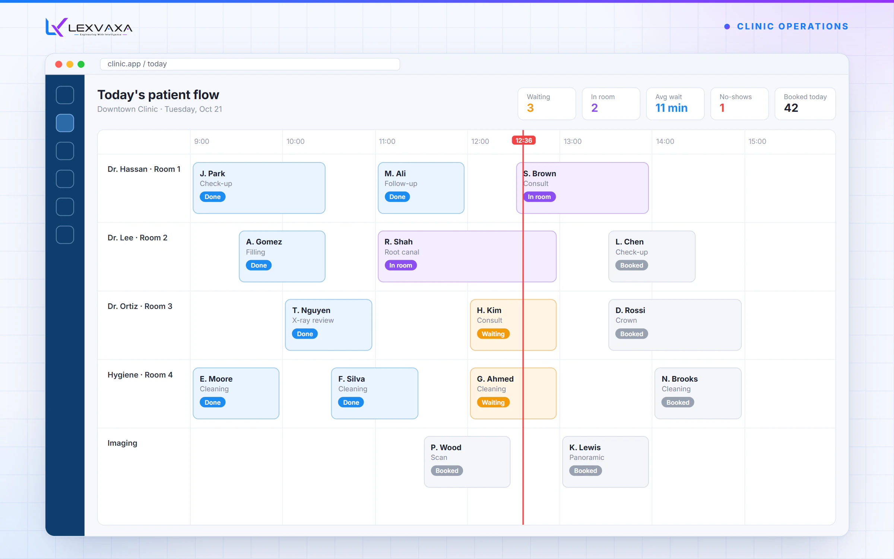

# Clinic Patient Flow Dashboard

**A live clinic dashboard that puts every provider and room on one schedule, with wait times, no-shows and appointment status in real time.**

       

## Overview

Clinic managers had no live view of bookings, no-shows or wait times. Lexvaxa built a custom dashboard connected to the clinic scheduling system that shows the whole day on one screen: each provider and room as a row, every appointment with its live status, and headline numbers for patients waiting, in the room, average wait and no-shows. Managers also see appointments per day and visits by department and booking channel. Screens shown use sample data, so no client records are exposed.

## The challenge

Bookings, no-shows and waiting patients were spread across the scheduling system and the front desk, so problems were only noticed after they caused delays.

## The solution

A React dashboard fed by the scheduling API through n8n and Supabase, showing a live day schedule, status colours and the key flow numbers.

## Key features

- Live day schedule by provider and room
- Appointment status: booked, waiting, in room, done
- Patients waiting, in room, average wait and no-shows
- Appointments per day trend
- Visits by department and booking channel
- Current time marker to spot running late

## Results

- Front desk and managers see the whole day at a glance
- Gaps and delays are caught early instead of after the fact

## Tech stack

React · Node.js · Python · n8n · Supabase · Scheduling API

## Demo

A working version of the dashboard UI with **sample data** is in [`demo/index.html`](demo/index.html). Download it and open it in a browser; it has no build step.

## Privacy

Client names and records are confidential. Every screen in this repository uses sample data, and source code that belongs to the client is not published.

## Links

- Case study on Lexvaxa: https://lexvaxa.com/work/clinic-patient-flow-dashboard
- Built by **Ch Muhammad Samiullah** ([GitHub](https://github.com/samiullah156-creator)) at [Lexvaxa](https://lexvaxa.com)
